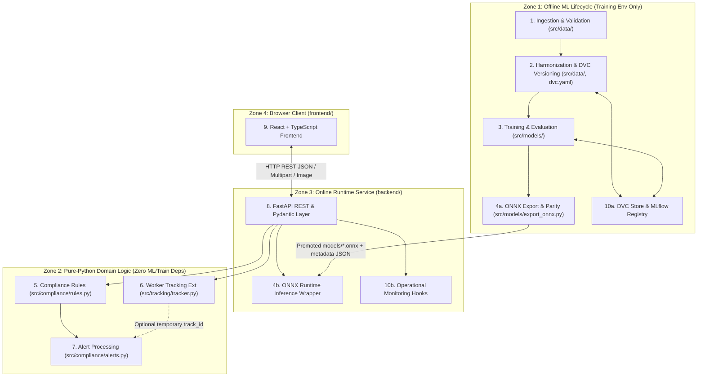
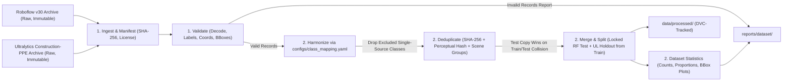
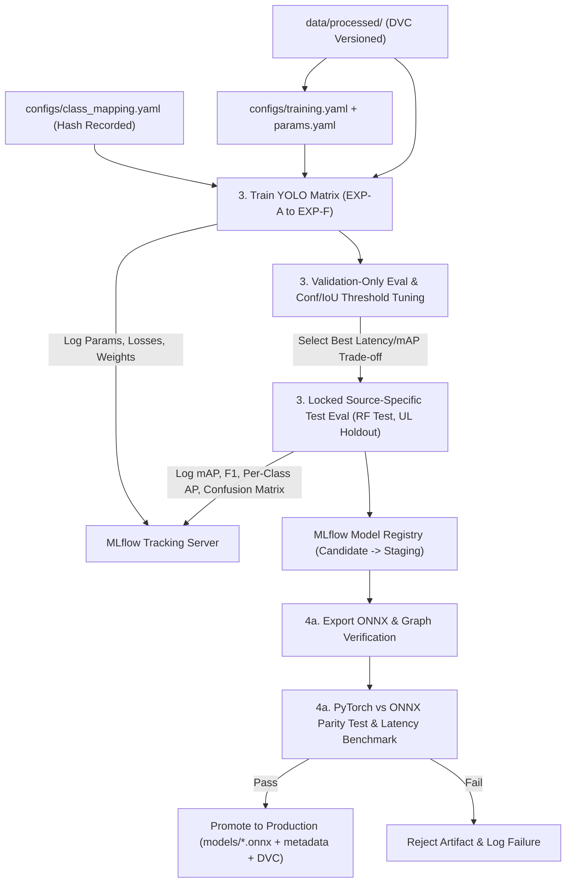
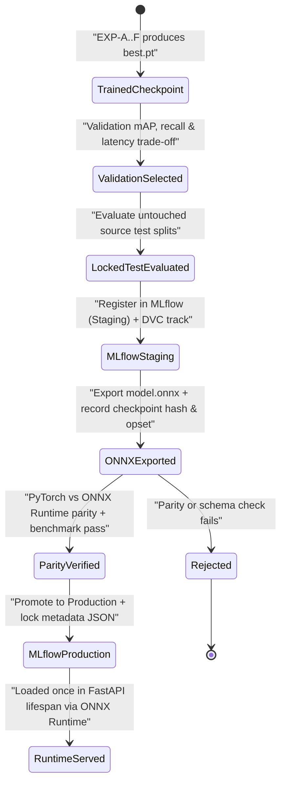
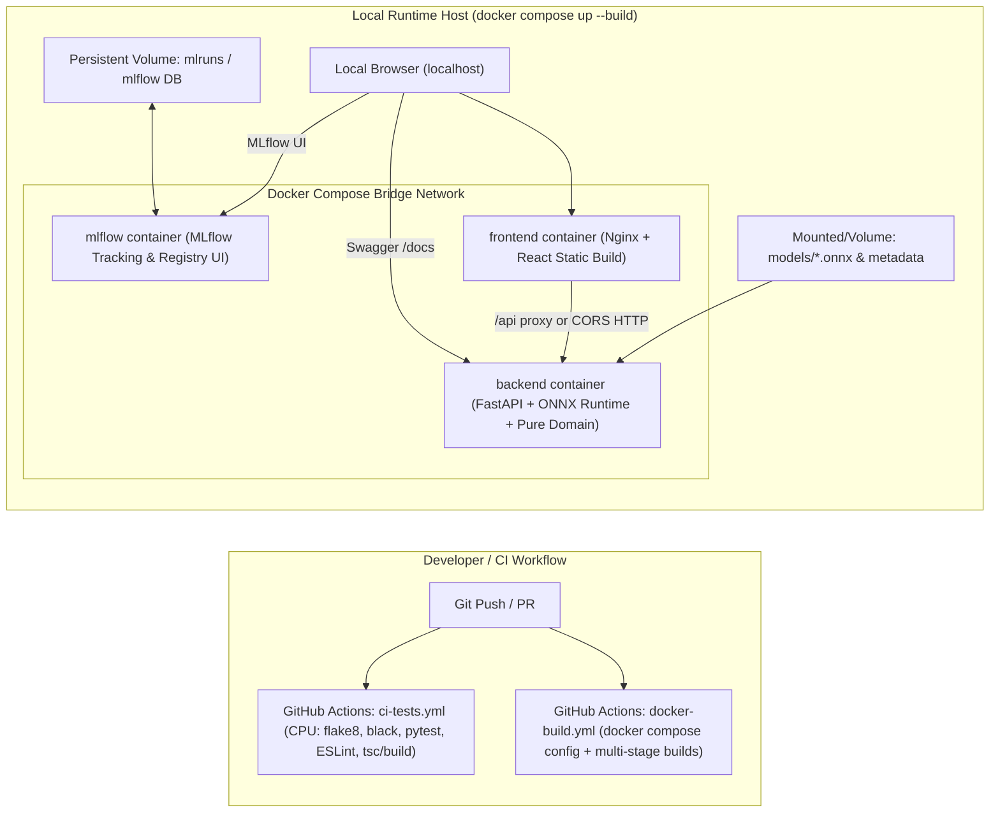
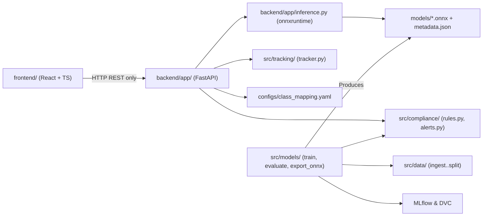

# SafeGuard — Final Software Architecture Design

**Status**: Proposed Final Architecture (For Review — No Implementation Started)  
**Normative Basis**: [`docs/reference/professor_project_guide.pdf`](../reference/professor_project_guide.pdf) (takes precedence), [`docs/reference/safeguard_specification_v1.pdf`](../reference/safeguard_specification_v1.pdf) (`SG-SPEC-001` V1.1), and [`docs/spec/requirements-traceability.md`](requirements-traceability.md).  
**Deployment Scope**: Local multi-service deployment via Docker Compose (`frontend`, `backend`, `mlflow`). No cloud deployment is introduced.

---

## 1. Architectural Overview & Subsystem Separation

SafeGuard strictly decouples the **Offline Model-Development Lifecycle** (dataset ingestion, harmonization, DVC pipeline, PyTorch/YOLO training, MLflow tracking, ONNX export/parity) from the **Online Runtime Inference System** (FastAPI + ONNX Runtime + pure-Python compliance/tracking/alerts + React TypeScript UI).

The system is decomposed into **10 separated subsystems** grouped across four architectural zones:

| Zone | Subsystem | Primary Package / Location | Core Responsibility |
|---|---|---|---|
| **Offline Data & MLOps** | **1. Dataset Ingestion & Validation** | `src/data/ingest.py`, `inspect.py`, `validate.py` | Pin immutable raw sources, record SHA-256/licenses/manifests, validate image readability, label pairing, class IDs, and bbox geometry. |
| **Offline Data & MLOps** | **2. Dataset Harmonization & Versioning** | `src/data/harmonize.py`, `deduplicate.py`, `split.py`, `stats.py`, `configs/class_mapping.yaml`, `dvc.yaml` | Map verified source labels to canonical IDs, exclude single-source classes, run SHA-256 + near-duplicate + scene-group checks, enforce locked test splits, generate dataset stats, and version via DVC. |
| **Offline Training** | **3. Model Training & Evaluation** | `src/models/architecture.py`, `train.py`, `evaluate.py`, `configs/training.yaml`, `params.yaml` | Execute `EXP-A`–`EXP-F` (`YOLO11n`, `YOLO11s`, `YOLOv8n`), tune thresholds on validation data only, evaluate locked source-specific test sets, and log runs/models to MLflow. |
| **Bridge (Offline Export / Online Infer)** | **4. Model Export & Inference** | Offline: `src/models/export_onnx.py`, `benchmark.py` / Online: `backend/app/inference.py` | Offline: export selected `best.pt` to ONNX, verify graph & PyTorch parity, benchmark latency/FPS. Online: load verified ONNX model **once** at FastAPI lifespan and run `onnxruntime` preprocessing, inference, and NMS/postprocessing. |
| **Pure Domain Logic** | **5. Compliance Rules** | `src/compliance/rules.py` | Pure-Python/NumPy geometric person-to-PPE association, uncertainty classification, and strict missing-PPE rule (`no_helmet` / approved `no_vest` only). |
| **Pure Domain Logic (Ext.)** | **6. Worker Tracking** | `src/tracking/tracker.py` | Optional extension (`EXT-01`): temporary anonymous ByteTrack-style frame-to-frame person track IDs. Zero biometrics, re-identification, or persistent profiles. |
| **Pure Domain Logic** | **7. Alert Processing** | `src/compliance/alerts.py` | Construct potential alert events from explicit missing-PPE signals, apply confidence thresholds, cooldowns, duplicate suppression, and human-review status. |
| **Online Serving Runtime** | **8. FastAPI** | `backend/app/main.py`, `schemas.py`, `config.py`, `monitoring.py` | Async REST API with Pydantic v2 validation, Swagger `/docs`, magic-byte/image-decode checks, size/dimension guardrails, semantic HTTP errors (`400`, `422`, `503`, `500`), and request-ID logging. |
| **Browser Client** | **9. React Frontend** | `frontend/src/` (`App.tsx`, `components/`, `services/`, `hooks/`, `types/`) | React + TypeScript UI with drag/drop image upload, 1-click licensed example gallery, bounded real-time webcam stream, dynamic bounding-box canvas, animated confidence bars, potential alerts, and separate server/client latency readouts. |
| **Cross-Cutting Ops** | **10. MLOps & Monitoring** | `dvc.yaml`, MLflow server, `docker-compose.yml`, `.github/workflows/`, `backend/app/monitoring.py` | DVC data/artifact versioning, MLflow tracking & Model Registry, Docker Compose local orchestration, CPU-compatible GitHub Actions CI, and operational metrics + proxy/statistical drift warnings. |

---

## 2. Subsystem Architecture & Module Boundaries



### Strict Boundary Rules
1. **Training vs. Runtime Wall**: `backend/` and `frontend/` **never** import `src/data/`, `src/models/`, `torch`, `ultralytics`, `dvc`, or `mlflow`.
2. **Pure Domain Wall**: `src/compliance/` and `src/tracking/` depend **only** on Python standard library, `numpy`, and `pydantic` (optional or lightweight dataclasses), allowing safe reuse by `backend/` and offline evaluation scripts without pulling training packages.
3. **Artifact-Only Handoff**: The sole bridge between Zone 1 (Offline) and Zone 3 (Runtime) is the versioned artifact bundle in `models/` (`model.onnx`, `model_metadata.json`) paired with `configs/class_mapping.yaml`.

---

## 3. Data Flow (Offline Pipeline)

Defines Subsystem 1 (Ingestion & Validation) and Subsystem 2 (Harmonization & Versioning) through DVC stages.



### Data Flow Invariants
- Raw files in `data/raw/` are never modified in place.
- Deduplication and scene/video grouping execute **before** splitting and **before** any training-only augmentation.
- `configs/class_mapping.yaml` is the single source of truth after the 7-step Taxonomy Approval Gate passes.

---

## 4. Training & Experimentation Flow

Defines Subsystem 3 (Model Training & Evaluation) and offline Subsystem 4a (Export & Parity).



---

## 5. Model Artifact Lifecycle



---

## 6. API Communication & Runtime Processing Flow

Defines Subsystem 4b (ONNX Inference), Subsystem 5 (Compliance Rules), Subsystem 6 (Worker Tracking), Subsystem 7 (Alert Processing), Subsystem 8 (FastAPI), and Subsystem 9 (React Frontend).

```mermaid
sequenceDiagram
    actor User as "Browser User"
    participant FE as "9. React + TS Frontend"
    participant API as "8. FastAPI Router & Validators"
    participant INF as "4b. ONNX Runtime Session"
    participant DOM as "5/6/7. Compliance, Tracking & Alerts"
    participant MON as "10b. Operational Monitoring"

    Note over API,INF: "Startup Lifespan: Load models/*.onnx & metadata once"

    User->>FE: "Select Upload / Example Gallery / Webcam"
    FE->>API: "GET /health & GET /model/metadata"
    API-->>FE: "200 OK (model_version, provider, classes, input_config)"

    alt "Image Upload or 1-Click Example"
        FE->>API: "POST /predict (UploadFile) [or POST /predict/visualize]"
        API->>API: "Check request_id, size, MIME + actual image decode"
        alt "Invalid / Corrupt / Oversized"
            API-->>FE: "400 Bad Request or 422 Validation Error"
        else "Model Not Loaded"
            API-->>FE: "503 Service Unavailable"
        else "Valid Image"
            API->>INF: "Preprocess -> ONNX Infer -> NMS/Postprocess (timed)"
            INF-->>API: "Raw detections + server timing breakdown"
            API->>DOM: "Geometric person-PPE association + potential alerts"
            DOM-->>API: "Associations + potential alert events"
            API->>MON: "Record latency, status, prediction counts, confidences"
            API-->>FE: "200 OK JSON (or annotated image for /predict/visualize)"
            FE->>FE: "Compute client E2E latency & render boxes/bars/alerts"
        end
    else "Real-Time Webcam Loop"
        Note over FE: "Bound in-flight requests; drop stale frames; preserve aspect ratio"
        loop "Controlled Capture Rate"
            FE->>API: "POST /predict (or optional POST /predict/frame)"
            API->>INF: "Run ONNX inference"
            INF-->>API: "Detections + server ms"
            API->>DOM: "Optional temporary track_id + compliance + cooldown alerts"
            DOM-->>API: "Frame result + potential alerts"
            API-->>FE: "200 OK JSON"
            FE->>FE: "Render synchronized boxes, FPS, alerts & client/server ms"
        end
    end
```

### Mandatory vs. Permitted Endpoints
- **Mandatory** (`professor_project_guide.pdf` p.6): `GET /health`, `GET /model/metadata`, `POST /predict`, `POST /predict/visualize` (+ Swagger UI `/docs`).
- **Permitted SafeGuard Extensions** (`SG-SPEC-001` p.14): `GET /classes`, `POST /predict/frame`.

---

## 7. Deployment & CI/CD Flow (Local Docker Compose + GitHub Actions)

Defines Subsystem 10 (MLOps, Docker Compose, GitHub Actions) with strict local-only deployment.



### Runtime Isolation Verification in Docker
- `backend/Dockerfile` uses a multi-stage Python slim image installing **only** `backend/requirements.txt` (`fastapi`, `uvicorn`, `pydantic`, `onnxruntime`, `numpy`, `pillow`/`opencv-python-headless`, `pyyaml`, `python-multipart`).
- `backend/Dockerfile` copies `backend/app/`, `src/compliance/`, `src/tracking/`, `configs/class_mapping.yaml`, and the exported `models/*.onnx` + `models/*metadata.json` artifact (or mounts `models/` via volume).
- `backend/Dockerfile` **never** installs `torch`, `torchvision`, `ultralytics`, `dvc`, or `mlflow`, and **never** copies `data/` or `src/data/` or `src/models/`.

---

## 8. Dependency Relationships & Forbidden Edges



### Explicit Dependency Matrix

| Source Module | Allowed Dependencies | Forbidden Dependencies |
|---|---|---|
| `src/data/` | Python stdlib, `pyyaml`, `numpy`, `pillow`/`opencv`, `imagehash`, `dvc`, `pandas` | `backend/`, `frontend/`, FastAPI |
| `src/models/` | `torch`, `ultralytics`, `onnx`, `onnxruntime`, `mlflow`, `src/data/`, `src/utils/`, `configs/` | `backend/`, `frontend/`, FastAPI |
| `src/compliance/` | Python stdlib, `numpy`, `pydantic` (optional/lightweight), `configs/class_mapping.yaml` | `torch`, `ultralytics`, `mlflow`, `dvc`, `src/data/`, `src/models/`, `fastapi` |
| `src/tracking/` | Python stdlib, `numpy` (ByteTrack-style association math) | `torch`, `ultralytics`, `mlflow`, `dvc`, `src/data/`, `src/models/`, `fastapi`, biometric/face libs |
| `backend/app/` | `fastapi`, `pydantic`, `uvicorn`, `onnxruntime`, `numpy`, `pillow`/`opencv-headless`, `pyyaml`, `src/compliance/`, `src/tracking/`, `models/*.onnx` | `torch`, `ultralytics`, `mlflow`, `dvc`, `src/data/`, `src/models/`, `data/` |
| `frontend/` | React, TypeScript, CSS framework, browser APIs (`MediaDevices`, `Canvas`, `fetch`/`axios`) | Direct file access to `models/`, `data/`, or Python code; simulated detections |

---

## 9. Proposed Final Repository Tree

Combines [`professor_project_guide.pdf`](../reference/professor_project_guide.pdf) (Section 6, p.7) and [`safeguard_specification_v1.pdf`](../reference/safeguard_specification_v1.pdf) (Section 12, p.17) while cleanly separating all 10 subsystems:

```text
SafeGuard/
├── .github/
│   └── workflows/
│       ├── ci-tests.yml                # CPU CI: flake8, black, pytest (data/compliance/api), frontend lint/build
│       └── docker-build.yml            # Docker Compose config check & multi-stage image builds
├── configs/
│   ├── class_mapping.yaml              # Single source of truth for canonical taxonomy (post-audit)
│   ├── data.yaml                       # Source dataset paths & split manifests config
│   └── training.yaml                   # YOLO experiment hyperparameters & validation-tuning settings
├── data/                               # DVC-managed ONLY (gitignored binaries)
│   ├── raw/                            # Immutable pinned Roboflow v30 & Ultralytics Nov 2026 archives + manifests
│   ├── interim/                        # Validated & harmonized intermediate datasets
│   └── processed/                      # Deduplicated, leakage-checked merged train/val & locked test splits
├── models/                             # DVC-managed selected checkpoints, ONNX exports & metadata JSON
├── reports/                            # Dataset audits, duplicate reports, experiment comparisons, benchmarks
├── scripts/                            # CLI helpers (dataset download verification, DVC/MLflow utilities)
├── src/
│   ├── __init__.py
│   ├── data/                           # Subsystems 1 & 2 (Offline Data Pipeline)
│   │   ├── __init__.py
│   │   ├── ingest.py                   # Pin sources, verify SHA-256 & licenses, emit source_manifest.json
│   │   ├── inspect.py                  # Extract source YAMLs, counts, sample label renders for taxonomy gate
│   │   ├── validate.py                 # Image readability, label pairing, class IDs, normalized coords
│   │   ├── harmonize.py                # Canonical mapping via class_mapping.yaml, drop excluded classes
│   │   ├── deduplicate.py              # SHA-256 exact + perceptual/embedding near-dups + scene grouping
│   │   ├── split.py                    # Leakage-aware train/val/holdout & locked test manifests
│   │   └── stats.py                    # Class distribution, image/box counts & plots
│   ├── models/                         # Subsystems 3 & 4a (Offline Training, Eval, Export)
│   │   ├── __init__.py
│   │   ├── architecture.py             # YOLO model factory (YOLO11n, YOLO11s, YOLOv8n)
│   │   ├── train.py                    # Training runner + MLflow parameter/metric/artifact logging
│   │   ├── evaluate.py                 # Val threshold tuning & locked test-set evaluation + MLflow registry
│   │   ├── export_onnx.py              # Export best.pt -> model.onnx, verify graph & PyTorch parity
│   │   └── benchmark.py                # PyTorch vs ONNX Runtime latency, P95, FPS, memory & size benchmark
│   ├── compliance/                     # Subsystems 5 & 7 (Pure-Python Domain Logic)
│   │   ├── __init__.py
│   │   ├── rules.py                    # Person-to-PPE geometric association & uncertainty classification
│   │   └── alerts.py                   # Potential alert generation, confidence/cooldown/dedup suppression
│   ├── tracking/                       # Subsystem 6 (Pure-Python Optional Extension)
│   │   ├── __init__.py
│   │   └── tracker.py                  # Temporary anonymous ByteTrack-style IDs (no biometrics/re-ID)
│   └── utils/
│       ├── __init__.py
│       ├── visualization.py            # Offline dataset/prediction rendering utilities
│       └── metrics.py                  # Detection & parity helper metrics
├── backend/                            # Subsystems 4b, 8 & 10b (Isolated Runtime Inference Service)
│   ├── Dockerfile                      # Multi-stage CPU/ONNX Runtime image (no torch/ultralytics/data)
│   ├── requirements.txt                # Runtime-only Python dependencies
│   ├── app/
│   │   ├── __init__.py
│   │   ├── config.py                   # Typed runtime settings (limits, model paths, thresholds)
│   │   ├── schemas.py                  # Strict Pydantic v2 request/response/error schemas
│   │   ├── inference.py                # ONNX Runtime wrapper (preprocess, infer, NMS/postprocess)
│   │   ├── monitoring.py               # Operational telemetry (latency/P95, errors, proxy dist stats)
│   │   └── main.py                     # FastAPI app, lifespan ONNX load, routes, request-ID logging
│   └── tests/
│       ├── __init__.py
│       └── test_api.py                 # Pytest suite (valid, invalid, empty, 503, boundary, parity)
├── frontend/                           # Subsystem 9 (React + TypeScript Client)
│   ├── Dockerfile                      # Multi-stage Node build -> Nginx static runtime
│   ├── package.json
│   ├── tsconfig.json
│   ├── public/
│   │   └── examples/                   # Preloaded, licensed example construction images
│   └── src/
│       ├── types/                      # TypeScript mirrors of Pydantic API schemas
│       ├── services/                   # Typed HTTP client calls to FastAPI
│       ├── hooks/                      # Bounded in-flight webcam frame scheduler & stream hook
│       ├── components/                 # Dropzone, ExampleGallery, WebcamStream, BoundingBoxCanvas, Alerts, Metrics
│       └── App.tsx                     # Root application layout & navigation
├── tests/                              # Unit tests for src/data, src/compliance, src/tracking, src/models parity
├── docs/
│   ├── reference/                      # Normative PDFs
│   ├── spec/                           # Traceability, ADRs, API contract, dataset strategy, software architecture
│   └── implementation/                 # Roadmap, team responsibilities, risk register
├── dvc.yaml                            # Reproducible DVC stages (ingest -> export)
├── params.yaml                         # Versioned pipeline parameters
├── requirements-train.txt              # Offline training/MLOps Python dependencies (isolated from backend/)
├── docker-compose.yml                  # Local multi-service stack: frontend, backend, mlflow
├── .dvcignore
├── .gitignore
├── GEMINI.md
├── README.md                           # 1-click setup & usage documentation
└── rapport_technique.pdf               # Final LaTeX-compiled technical report
```

---

## 10. Architectural Decision Records Summary

Full ADR records are maintained in [`docs/spec/architecture-decisions.md`](architecture-decisions.md):

- **ADR-01**: Decoupled Development Lifecycle vs. Runtime Inference
- **ADR-02**: Single-Axis Scope — Axis 3 Real-Time Object Detection
- **ADR-03**: Standardized Repository Layout
- **ADR-04**: ONNX Runtime Single-Load Inference Service Pattern
- **ADR-05**: Separation of Detection, Geometric Association, and Compliance Alerts
- **ADR-06**: React + TypeScript Frontend & Bounded Real-Time Streaming
- **ADR-07**: Local Multi-Service Docker Compose & CPU-Compatible CI
- **ADR-08**: Operational Monitoring vs. Drift Claims & Privacy Defaults
- **ADR-09**: Pure-Python Domain Isolation for Compliance, Tracking & Alerts (`src/compliance/`, `src/tracking/`)
- **ADR-10**: Separate Training vs. Runtime Dependency Graphs & Docker Contexts
- **ADR-11**: Local-Only Container Orchestration (No Cloud Deployment Scope)
